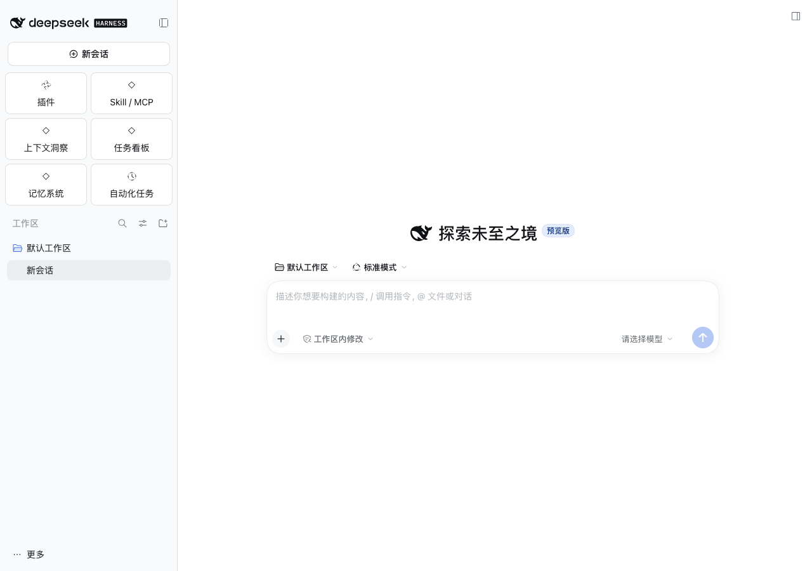
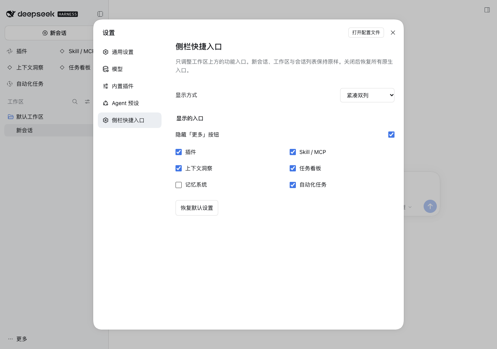

# Sidebar Shortcuts / dsh-sidebar-shortcuts

Arrange the native shortcuts above Workspaces in DeepSeek Harness as compact columns or icon tiles. Original buttons, click handlers, selection, and keyboard behavior are retained.

[简体中文](README.md) · MIT · No runtime dependencies

[](https://github.com/DEVbyQIN/dsh-sidebar-shortcuts/actions/workflows/verify.yml)

## Settings

Open **More (bottom of sidebar) → Settings → Sidebar Shortcuts**. Older versions have a direct Settings button:

- **Icon tiles**: default; two columns with icons above labels.
- **Compact columns**: two columns with icons beside labels.
- **Off — native sidebar**: restores native layout and every entry while keeping your preferences for later.
- **Hide the More button**: enabled by default; can be turned off.
- **Visible entries**: choose which registered panels remain visible. New plugin entries appear by default.

New Session, branding, Workspaces, and session browsing stay native. Collapsed or very narrow sidebars keep the native layout. The settings section remains accessible even when all panel shortcuts are hidden.

Preferences use localStorage for the current browser/desktop origin, synchronize between same-origin windows, and make no model calls. Hiding entries does not uninstall features or change DSH's native panel pin preferences.

## Installation

### Desktop

Open **Plugins → Add plugin → Install an existing plugin** in DSH and enter:

```text
github:DEVbyQIN/dsh-sidebar-shortcuts
```

Install, enable, and reload the UI. Electron exclusively manages its `desktop` profile; use the in-app plugin manager.

### Web

```sh
dsh plugin --profile web add github:DEVbyQIN/dsh-sidebar-shortcuts
```

If the settings section does not appear, reload the UI or restart DSH. GitHub installation is available; the package is not published to npm.

## Preview

Screenshots use isolated DSH 0.2.1-rc.4 with empty data and synthetic panel entries.





## Local development

```sh
git clone https://github.com/DEVbyQIN/dsh-sidebar-shortcuts.git
cd dsh-sidebar-shortcuts
node --test test/verify.mjs
dsh plugin --profile web add "link:$PWD"
```

For Desktop development, enter the absolute clone directory in the in-app installer.

## Verification

```sh
node --test test/verify.mjs
```

Tests cover module contracts, validation, both layouts, native mode, visibility, rail/narrow behavior, dynamic panels, settings, storage synchronization/failures, and disposal. Real-host checks use isolated DSH data and synthetic panel entries.

Disabling the plugin removes its styles, DOM markers, settings section, and listeners; original DOM and saved preferences are preserved.
